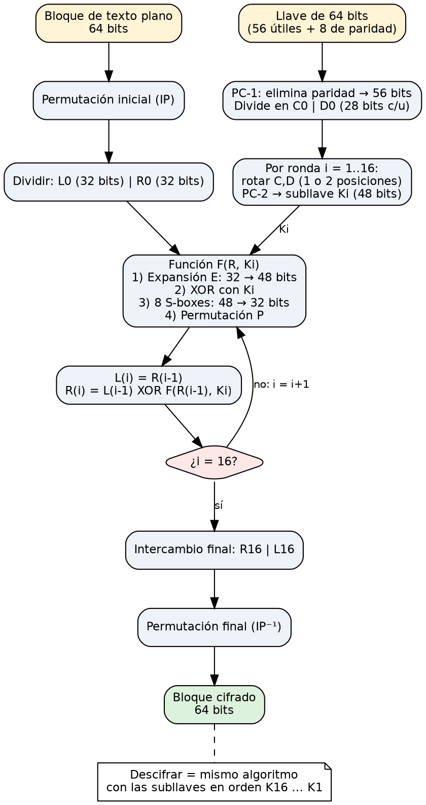

# Proyecto 2 – Informe, sección de la Persona 1
**Cifrado DES, versión secuencial y acercamiento alternativo 1 (distribución cíclica)**

## 1. Antecedentes: DES
DES (Data Encryption Standard) es un cifrador de bloque simétrico tipo **red de Feistel**: cifra bloques de **64 bits** con una llave de **64 bits, de los cuales 56 son útiles** (8 son de paridad). Por eso el espacio de búsqueda es 2^56 ≈ 7.2 × 10^16 llaves, lo que lo hace atacable por fuerza bruta.

### Pasos para cifrar un bloque
1. **Permutación inicial (IP)** del bloque de 64 bits, que luego se divide en mitades L0 y R0 de 32 bits.
2. **Generación de subllaves:** PC-1 descarta los bits de paridad y deja 56 bits, partidos en C0 y D0 de 28 bits. En cada una de las 16 rondas, C y D se rotan a la izquierda (1 o 2 posiciones) y PC-2 produce una subllave Ki de 48 bits.
3. **16 rondas de Feistel:** L(i) = R(i-1) y R(i) = L(i-1) ⊕ F(R(i-1), Ki). La función F hace: expansión E (32→48 bits), XOR con Ki, ocho **S-boxes** (48→32 bits, la única parte no lineal) y la permutación P.
4. **Intercambio final** de mitades (R16 | L16) y **permutación final IP⁻¹**, que da el bloque cifrado de 64 bits.

### Descifrado
Es el mismo algoritmo con las subllaves aplicadas en orden inverso (K16 … K1); esa es la propiedad que ofrece la estructura de Feistel.

### Texto de varios bloques
Se usa el modo **ECB**: cada bloque de 8 bytes se cifra de forma independiente; el texto se rellena con ceros hasta completar el último bloque.



## 2. Implementación
Como `rpc/des_crypt.h` no está disponible en los sistemas actuales, se usó la implementación DES de **OpenSSL** (`DES_ecb_encrypt`) envuelta en `des_lib.c`. La llave de 56 bits se expande a 8 bytes (7 bits de llave + 1 bit de paridad impar por byte) y se descarta la verificación de llaves débiles para no excluir llaves del espacio de búsqueda.

**Verificación (captura a incluir):**
```
$ ./des_tool enc texto.txt cifrado42.bin 42
Texto cifrado: 32 bytes -> 'cifrado42.bin' (32 bytes con relleno), llave=42
$ ./des_tool dec cifrado42.bin 42
Texto descifrado: "Esta es una prueba de proyecto 2"
$ ./des_tool dec cifrado42.bin 43      (llave incorrecta → basura)
```

## 3. Explicación de las rutinas
**`encrypt(key, buf, len)` / `decrypt(key, buf, len)`** (`des_encrypt` / `des_decrypt`): expanden la llave de 56 bits a 64 con paridad, calculan las 16 subllaves una sola vez (`DES_set_key_unchecked`) y recorren el buffer bloque a bloque aplicando `DES_ecb_encrypt` con modo cifrar o descifrar. Es **in place**: la salida sobrescribe la entrada, y `len` debe ser múltiplo de 8.

**`tryKey(key, ciph, len)`** (`des_try_key`): decide si una llave es la correcta. Copia el cifrado a un buffer de trabajo (`memcpy`), lo descifra con la llave candidata, le agrega `'\0'` y busca la frase clave con `strstr`. Retorna 1 si aparece. La copia es necesaria porque el descifrado es destructivo y el cifrado original debe conservarse para el siguiente intento.

**`memcpy(dst, src, n)`:** copia byte a byte (en bloques optimizados) `n` bytes de `src` a `dst`; no revisa solapamiento ni terminador. Aquí aísla el texto cifrado original de cada intento.

**`strstr(haystack, needle)`:** recorre `haystack` buscando la primera aparición de la subcadena `needle`; retorna un puntero a ella o `NULL`. Se detiene en el primer `'\0'`, por eso el buffer debe terminar en `'\0'`. Una llave incorrecta produce bytes aleatorios; que contengan por azar una frase de 16 caracteres es prácticamente imposible, de ahí la recomendación de usar frases largas.

## 4. Versión secuencial: tiempos
`secuencial.c` prueba las llaves 0, 1, 2, … hasta encontrar la correcta. Peor caso por longitud de llave (última llave del espacio 2^b), medido con 1 núcleo:

| Bits | Iteraciones | Tiempo (s) | Mllaves/s |
|---|---|---|---|
| 16 | 65,536 | 0.035 | 1.86 |
| 20 | 1,048,576 | 0.545 | 1.93 |
| 22 | 4,194,304 | 2.176 | 1.93 |
| 24 | 16,777,216 | 8.707 | 1.93 |

El tiempo crece linealmente con 2^b (cada bit extra lo duplica). Extrapolando, a ~1.9 M llaves/s un núcleo necesitaría ≈ 2^56 / 1.9×10^6 s ≈ **1,200 años** para recorrer todo el espacio. Con la llave 123456 la búsqueda secuencial tarda 0.07 s (123,457 iteraciones).

## 5. Acercamiento alternativo 1: distribución cíclica
**Idea.** En el enfoque naive el proceso r recorre un rango contiguo, por lo que el tiempo depende de en qué segmento cae la llave. En el cíclico, el proceso r prueba las llaves r, r+p, r+2p, … (p = número de procesos): todos recorren *todo* el espacio en forma entrelazada, así que cualquier llave k se encuentra tras ⌊k/p⌋ + 1 iteraciones del proceso ganador.

**Pseudocódigo**
```
post MPI_Irecv(aviso, ANY_SOURCE)
for k = rank; k < 2^bits; k += p:
    if try_key(k): MPI_Send(k) a todos los demás; break
    cada 4096 iteraciones: MPI_Test(aviso) → si llegó, salir
reducir: llave, iteraciones por proceso, tiempo máximo
```
**Terminación anticipada:** `MPI_Irecv` abierto + `MPI_Test` periódico (cada 4096 intentos, para no pagar costo de comunicación en cada iteración) + `MPI_Send` del ganador.

## 6. Pruebas: fácil / mediana / difícil
Como las llaves de la guía son inalcanzables en tiempo razonable, se escalaron proporcionalmente al espacio S = 2^22 (misma fórmula de la guía). T_par se mide en **iteraciones del proceso ganador** (independiente del hardware); p = 4.

| Llave | Valor | Sec. (iter) | Naive (iter) | Speedup naive | Cíclico (iter) | Speedup cíclico |
|---|---|---|---|---|---|---|
| Fácil: S/2 + 1 | 2,097,153 | 2,097,154 | 2 | 1,048,577 | 524,289 | 4.00 |
| Mediana: S/2 + S/8 | 2,621,440 | 2,621,441 | 524,289 | 5.00 | 655,361 | 4.00 |
| Difícil: ⌈S/7 + S/13⌉ | 921,826 | 921,827 | 921,827 | 1.00 | 230,457 | 4.00 |
| Naive mejor: S/4 + 1 | 1,048,577 | 1,048,578 | 2 | 524,289 | 262,145 | 4.00 |
| Naive peor: S/4 − 1 | 1,048,575 | 1,048,576 | 1,048,576 | 1.00 | 262,144 | 4.00 |

*Las columnas "Sec." y "Cíclico" se midieron ejecutando los programas; la columna "Naive" se calculó analíticamente a partir de su definición (rangos contiguos de S/p llaves) y debe contrastarla la Persona 2 con su ejecución real.*

**Análisis.** El naive da speedups de 1 a más de 10^6 según la posición de la llave, un resultado engañoso. El cíclico entrega un speedup casi constante ≈ p para toda llave, de modo que el tiempo paralelo esperado es k/p sin variación. La consistencia es lo que lo hace preferible cuando la posición de la llave es desconocida.

**Limitaciones honestas.** (1) Las iteraciones totales de los demás procesos pueden exceder las del ganador hasta en 4096 por la frecuencia de `MPI_Test`. (2) Las pruebas se hicieron en una máquina de 1 núcleo, por lo que los tiempos de pared con `-np 4` no muestran speedup real; los tiempos y speedups medidos en segundos deben repetirse en la laptop del equipo (p. ej. con `-np 4` y `-np 8`) y registrarse en la bitácora.

## 7. Referencias sugeridas (verificar y citar en formato UVG)
- NIST, FIPS PUB 46-3: *Data Encryption Standard (DES)*, 1999.
- Barlas, G. *Multicore and GPU Programming: An Integrated Approach*, Morgan Kaufmann.
- OpenSSL Project, documentación de `DES_ecb_encrypt` (man page).
- Open MPI Project, documentación de `MPI_Irecv`, `MPI_Test`, `MPI_Send`.
